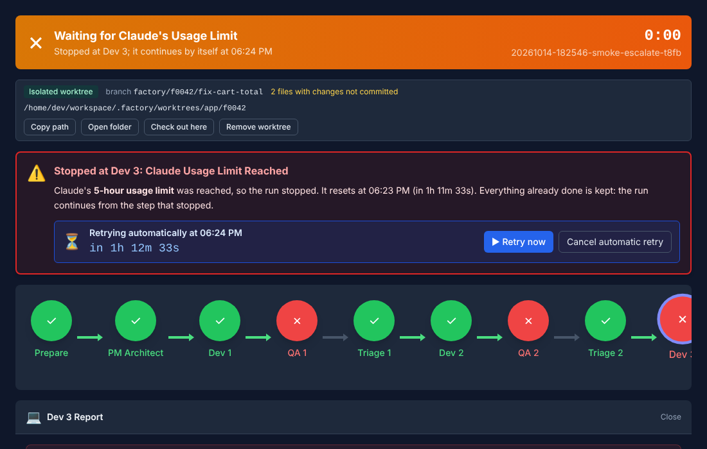
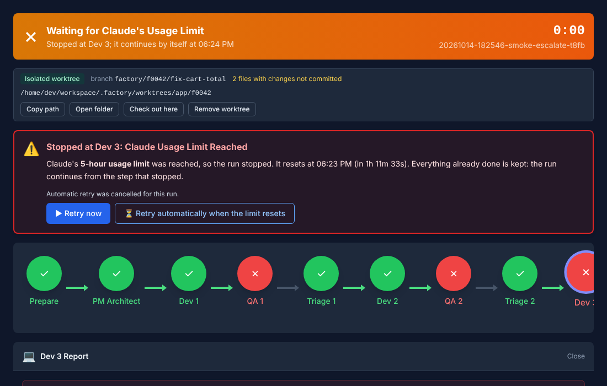
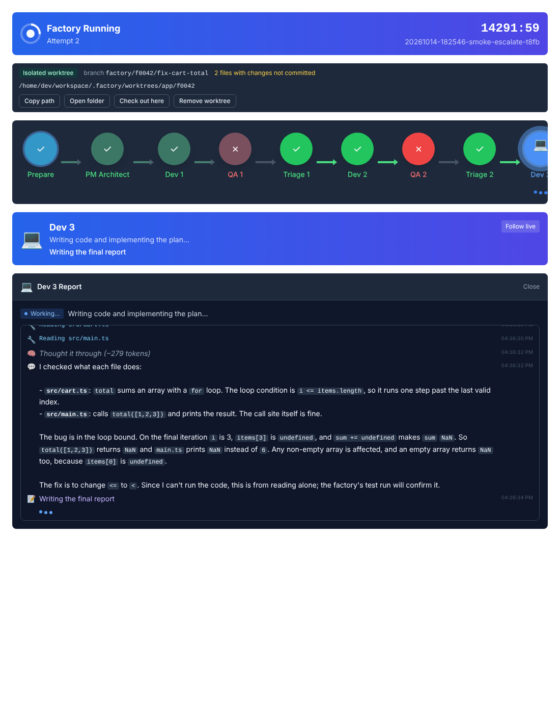
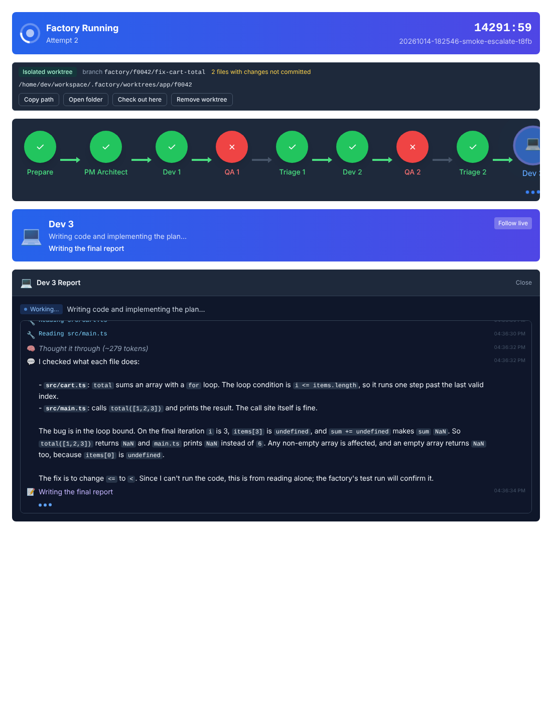

# Work log

What was built in this repository by an AI assistant, feature by feature, **newest first**: what changed,
why, how it was verified, the decisions taken without asking, and what to check yourself. Each entry is
written to be read on its own, e.g. the next morning.

| Date | Feature | Status |
| --- | --- | --- |
| 2026-10-24 | [Automatic retry when Claude's usage limit resets](#2026-10-24--automatic-retry-when-claudes-usage-limit-resets) | Merged into `master` |
| 2026-10-24 | [Live agent activity](#2026-10-24--live-agent-activity) | Merged into `master` |
| 2026-10-24 | [Free tier for the small roles, and which model did each step](#2026-10-24--free-tier-and-model-visibility) | Merged into `master` |

---

## 2026-10-24 — Automatic retry when Claude's usage limit resets

You asked: when Claude's tokens run out mid-run, retry by itself once they are back, instead of you
watching the clock and pressing "Retry"; with a way to switch it off. Your answers to my three questions:
**the Studio waits and retries** (not the factory process), **a setting, on by default, plus Cancel per
run**, and **any wait**, a weekly limit days away included.

**Short version.** A run stopped by the usage limit now says which limit and when it resets, counts down,
and continues by itself a minute after the reset, from the step that stopped, keeping everything already
done. "Retry now" and "Cancel automatic retry" are on the run; a switch in Settings turns it all off.





(Rendered from the real Studio components in Chromium; the backdrop is a recorded run. Light theme:
`docs/auto-retry/retry-scheduled-light.png`.)

### What was there before

A refused call failed the run with "Claude subscription usage limit reached… resume once the window
resets", and "Retry run" already continued from the failed step. What was missing: knowing *when* it
resets, and someone to press the button then. The CLI does say when: every call's stream carries a
`rate_limit_event` with the exact reset time and the window (`five_hour`, `seven_day`); I saw it in the
transcripts recorded for the live activity.

### What I built

**Factory** (`factory/src/utils/usage-limit.ts`):
- A refused call is recognised from the stream, even when the error text does not name the limit, and
  reports `usageLimit: { resetsAt, window }`; the error text ("resets 7:20pm", "…|1792862400", "resets in
  2 hours") is the fallback.
- Each refused call writes a `usage_limit` event; the live activity says "Claude's 5-hour limit is used up:
  it resets at …".
- A run that fails on it gets `usageLimit` in `summary.json`, tied to *this* failure (a limit from an
  earlier attempt never explains a later, different failure).

**Studio** (`studio/electron/services/auto-retry.ts`, `UsageLimitRetry.tsx`):
- When a run's process ends on the limit, the main process writes a plan, `auto-retry.json` in the run
  directory: retry at the reset + 1 minute (every 30 minutes when the reset time is unknown).
- Every 15 seconds it checks the wall clock and resumes the runs that are due, from the step that stopped
  (the same `factory resume` as "Retry run"), and tells the screen. A laptop that slept through the moment
  retries on waking; a Studio that was closed retries when it opens (10 seconds after start). If another run
  works in the same place, it waits 2 more minutes; if the resume cannot start (signed out), 5 more.
- If the retry hits the limit again, a new plan is made from the new reset time; after 6 automatic retries
  in a row it stops and says so.
- On screen: the header turns amber, "Waiting for Claude's Usage Limit — it continues by itself at 18:24";
  the run's panel names the limit, when it resets, and counts down to the retry with **Retry now** and
  **Cancel automatic retry**; the history shows "⏳ Usage limit reached: retrying automatically at …".
- **Settings → "Retry automatically when Claude's usage limit resets"**, on by default. Off (or cancelled,
  or given up): the run offers "⏳ Retry automatically when the limit resets" for that run alone.
- Pressing "Retry run" / "Retry now" yourself drops the plan.

### How it was verified

- **The factory, end to end, with a stand-in `claude`** that answers like a used-up 5-hour limit: a real
  `factory run` stopped at the PM step with "Claude's 5-hour limit is used up", `summary.json` got
  `usageLimit: { resetsAt: 17:20, window: five_hour }`, and the Studio's own code read it from that run
  directory and planned the retry for 17:21. A real `factory resume` of it went straight back to the PM step
  (the run namer was not repeated) and recorded the limit again.
- **Tests.** Factory: 699 pass (new: the reset time from the stream and from five forms of error text, a
  real `runClaudeCli` against a fake `claude` binary, the event and the activity line). Studio: 438 pass
  (new: when to retry, what to do when a run ends, the retry loop with busy / signed-out / retried-by-hand
  cases, reading a stopped run from disk, the panel, the countdown, Cancel and arm, the header, the setting).
  Smoke: 155/155. Typecheck clean; the Electron main process and preload build.
- **Screenshots** above, from the real components.

Not verified: the Electron app itself was not launched (no display here), so the 15-second clock and the
resume it starts were tested through their logic, not in the running app; and no real Claude account was
taken to its limit. The pre-existing `round-commit.test.ts` failure is unchanged (see the previous entry).

### Decisions I made without asking you

- Retry **a minute after** the reset, not at it: the window has to be open on Anthropic's side too.
- **Give up after 6** automatic retries in a row that hit the limit again, so a wrong reset time cannot
  loop for ever; arming it by hand starts a fresh count.
- Unknown reset time: **every 30 minutes**.
- Only task runs and their rounds are retried, not the pull-request triage (the watcher handles that).
- The CLI keeps the old message (`resume --run-id …`) and now adds the window and reset time; there is no
  waiting in the CLI itself (you chose the Studio).

### What to check

1. Settings: the new switch is there and on.
2. When a run next hits the limit: the amber header, the countdown, and that it continues by itself after
   the reset. If it did not, look at `logs/<runId>/summary.json` (`usageLimit`) and `auto-retry.json` (the
   plan, `status`, `retryAt`, `tries`), and the Studio's console for `[auto-retry]` lines.

### Commits

| Commit | What |
| --- | --- |
| `1efa14e` | docs: turn the live activity report into a work log for every feature |
| `2ddc460` | feat(factory): record when Claude's usage limit resets |
| `1b68caf` | feat(studio): retry a run by itself when Claude's usage limit resets |
| `427e6dd` | docs: document the automatic retry after Claude's usage limit |

---

## 2026-10-24 — Live agent activity

You asked to see, in real time and for every step (PM, architect, developer, QA, review, security,
docs, ...), what the AI is doing.

**Short version.** It works now. Every agent call writes what it is doing, as it does it, and the Studio
shows it under each running step and in a live feed. It was verified against the real Claude Code CLI
(not only against mocks). You have not tried it yet: the checklist at the end is what to look at first.


### 1. What was wrong

Some streaming existed, which is why it looked "done" before, but almost nothing reached the screen:

| What the Claude CLI streams | Before | Why |
| --- | --- | --- |
| What the model says while it works ("I'll read cart.ts first…") | **Dropped** | Text was printed only for calls *without* a JSON schema, and every agent has one. |
| Tool calls | `[tool] Read` only | The name was printed when the call *started*, before its input (the file, the search) was known. |
| Failed tool calls ("File does not exist") | Not shown | Not read. |
| Thinking, the report being written, the turn summary | Not shown | Not read. |
| Free tier and `api` backend | Nothing | No streaming at all. |

And on the Studio side, console lines were assigned to steps **by timestamp**. The tool lines had no
timestamp, and review and security run at the same time, so what little was printed often landed under
the wrong step. The "Live Output" box only showed the last 30 raw console lines, and only when no step
was selected.

To know exactly what the CLI sends, I recorded two real calls of `claude --output-format stream-json
--include-partial-messages --json-schema …` (Claude Code 2.1.310, haiku). They are in
`fixtures/claude-stream/` and the tests replay them.

### 2. What I built

#### Factory (`factory/src/utils/agent-activity.ts`)

Every agent call writes **`logs/<runId>/activity.ndjson`**, one JSON line per thing it does:

| `kind` | Example |
| --- | --- |
| `call-start` | `Asking Claude (sonnet)` / `Asking google/gemini-3.1-flash-lite (free tier)` |
| `text` | `I'll read src/cart.ts and src/main.ts first, then check how main.ts calls into the cart.` (streamed, in readable pieces) |
| `thinking` | `Thought it through (~279 tokens)` (Anthropic redacts the thinking text; only its size is known) |
| `tool` | `Reading src/cart.ts`, `Searching for "add" in src (*.ts)`, `Editing src/Button.tsx`, `Listing files matching **/*.test.ts` |
| `tool-error` | `File does not exist. …` |
| `report` | `Writing the final report` (the model is filling in its structured answer) |
| `summary` | `off-by-one in cart.ts total(): <= makes sum NaN` (the CLI's one-line summary of a turn) |
| `notice` | `gemini-3.1-flash-lite: rate-limit after 0.4s (…)`, `The answer did not match the expected format: asking haiku again` |
| `call-end` / `call-failed` | `Answered by claude-sonnet-4-6 in 42.1s · 7 tool turns` (+ tokens) / the reason |

- Every entry carries `call`, `role`, `step` and `attempt`, so nothing is guessed from the clock and
  parallel steps never mix.
- Text deltas are gathered into readable pieces (a line, ~160 characters, or whatever came in the last
  0.4 s), so the screen moves while the model writes without one entry per word.
- The same entries are echoed to the console: `  [reviewer] 🔧 Reading src/cart.ts`. That is what makes
  the Studio refresh (it refreshes on every console line), and it makes the CLI readable too.
- Sources: the Claude CLI stream (`ClaudeStreamParser`), the free tier (each model asked and why it did
  not answer), and the `api` backend (each tool call and text step, via Mastra's `onStepFinish`).

#### Studio

- **Banner of each running step**: under "Dev 3 — Writing code…" a white line with the newest thing its
  agent did ("Reading src/cart.ts", or the sentence it is writing). A **Follow live** button opens the feed.
- **Live feed** (in the step's panel, `ActivityFeed.tsx`): per call, the model and backend, then
  everything it did with a time, what it says rendered with `code` and **bold**, a working indicator, and
  it follows the newest line unless you scroll up to read.
- **Finished steps** keep it under their report: "What the agent did (N tool calls)", collapsed.
- Old runs (before today) have no `activity.ndjson`; they show the console lines as before.
- New IPC channel `factory:get-activity`, read incrementally (only new lines on each refresh; a line the
  factory is still writing is picked up on the next read, never lost).

Screenshots, rendered from the real Studio components with the real activity of an end-to-end call:





(The odd elapsed clock and the "Dev 3" step come from the recorded run used as a backdrop; the feed
itself is a real reviewer call on a small repo with an off-by-one bug.)

### 3. How it was verified

- **Real end to end.** One real agent call through the factory's own `invokeAgent` → real `claude` CLI →
  `activity.ndjson`. Over 10 seconds it recorded: asking haiku, thinking, "I'll read src/cart.ts and
  src/main.ts first…", reading both files, the explanation of the bug paragraph by paragraph, writing the
  report, the summary, "Answered by claude-haiku-5-5 in 10.0s · 3 tool turns". That file is kept as
  `fixtures/claude-stream/reviewer-activity.ndjson`.
- **Tests.** Factory: 686 pass, 1 unrelated failure noted below (new: the parser replayed from the two real transcripts cut into random
  chunks, text gathering, tool descriptions, a full `invokeAgent` call, a failed call, the free tier's live
  entries). Studio: 418 pass (new: incremental reading, matching activity to steps and attempts, the feed,
  the banner and "Follow live" in the real pipeline view of a live run). Typecheck clean on both.
- **Smoke test**: `npm run smoke` passes, 155/155 checks across the 15 workflow scenarios. (In this sandbox
  it has to be run with `FACTORY_WORKSPACE_ROOT=/home/user`, because the repository sits outside the default
  `~/workspace`. That, not the code, is why I said in earlier sessions that smoke "fails here".)
- **Screenshots** above: the Studio components built with Vite and rendered in Chromium, no console errors.

Not verified here:
- The Electron app itself was not launched (no display in this environment). Everything it adds is one
  IPC handler calling a tested function; the renderer parts are tested.
- One factory test, `round-commit.test.ts`, was already failing before today: its recorded triage fixture
  has no `comments` list and `src/cli/revision.ts:165` expects one. Unrelated; not touched.

### 4. Decisions I made without asking you

- **Thinking is shown as "Thought it through (~N tokens)"**: the API does not give its text.
- **The final JSON report is not streamed character by character**: it is the same content you then see
  in the step report; the feed says "Writing the final report" instead.
- **Activity stays with the run** (`activity.ndjson`), so you can read tomorrow what each agent did today,
  not only while it runs.
- **Polling, not a new push channel**: the Studio already refreshes on each console line (≤ 0.4 s
  debounce), and each activity entry prints one. Simpler and nothing new to break.

### 5. Tomorrow: how to look at it

```bash
cd ~/workspace/agent-software-factory
git fetch origin && git checkout claude/adoring-hamilton-x9t92q && git pull
npm install
npm run check            # typecheck + tests + smoke
npm run dev:studio       # then start any task on a small repository
```

What you should see:
1. While a step runs, its blue banner has a second white line that changes as the agent works.
2. **Follow live** (or clicking the step) shows the feed: `▶ Asking Claude (sonnet)`, `💬` what it says,
   `🔧 Reading …`, `📝 Writing the final report`, and at the end `✓ done in …s · N tokens` in the header.
3. Review and security, running together, each show only their own activity.
4. After the run, open any step: "What the agent did" under its report.
5. On the console (`npm run factory -- run …`) the same lines appear as `  [developer] 🔧 Editing …`.

If the feed stays empty while a step runs, look for `logs/<runId>/activity.ndjson`: if it is there and
growing, the Studio side is at fault; if not, the factory side (send me the run's `output.log`).

*(Update: merged into `master` on 2026-10-24, at your request, together with the automatic retry. Work from `master`: `git checkout master && git pull`.)*

This work is on branch `claude/adoring-hamilton-x9t92q`. **It is not merged into `master`**: you have not
seen it run yet. When you are happy, merge it (fast-forward) or ask me to.

### 6. Commits

| Commit | What |
| --- | --- |
| `5ae8389` | feat(factory): record what each agent call is doing, live |
| `1e3ab54` | feat(studio): show what each step's agent is doing, as it happens |
| `a18f98f` | docs: document the live activity of the agents |
| `3268977` | docs: report of the live activity work, with screenshots (now this work log) |

Files: `factory/src/utils/agent-activity.ts` (new), `factory/src/utils/agent-runner.ts`,
`factory/src/utils/claude-cli.ts`, `factory/src/utils/free-tier.ts`, `studio/shared/activity.ts` (new),
`studio/src/components/ActivityFeed.tsx` (new), `studio/src/components/AgentDetail.tsx`,
`studio/src/components/PipelineView.tsx`, `studio/electron/ipc/factory.ts`,
`studio/electron/services/run-state.ts`, `studio/shared/{types,events}.ts`, tests, `fixtures/claude-stream/`,
`README.md` and `factory/README.md` (new "Live activity" section).

---

## 2026-10-24 — Free tier and model visibility

**Short version.** The small roles that need no tools (`run-namer`, `merge-summary`, `pr-writer`,
`phase-reconciler`) can try free-quota models (Gemini Flash-Lite) before Claude; the Studio shows which
model did each step and warns when another model had to take over, e.g. because one was out of quota.

- Opt-in in `factory/.env`: `FACTORY_FREE_ROLES=run-namer,merge-summary,pr-writer` and
  `FACTORY_FREE_CHAIN=google/gemini-3.1-flash-lite,google/gemini-3.5-flash-lite` (plus the provider keys).
- Measured first with `npm run eval:free` on your laptop: both Gemini Flash-Lite models answered 14/14
  sample requests in the right shape; your Groq key has `openai/gpt-oss-120b`, `openai/gpt-oss-20b`,
  `qwen/qwen3.8-27b`; Mistral's free plan does not allow API keys.
- Details: `factory/README.md`, section "Free tier (optional)".
- Commits: `849aa3e`, `c49866d`, `7b847f0`, `0acbbea`, `d18e682` (merged into `master`).
